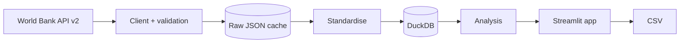
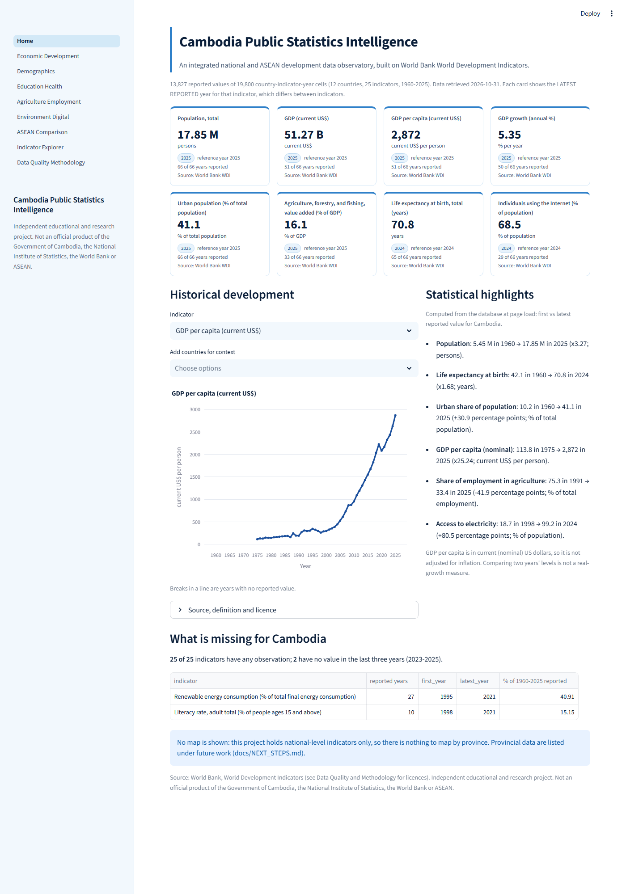
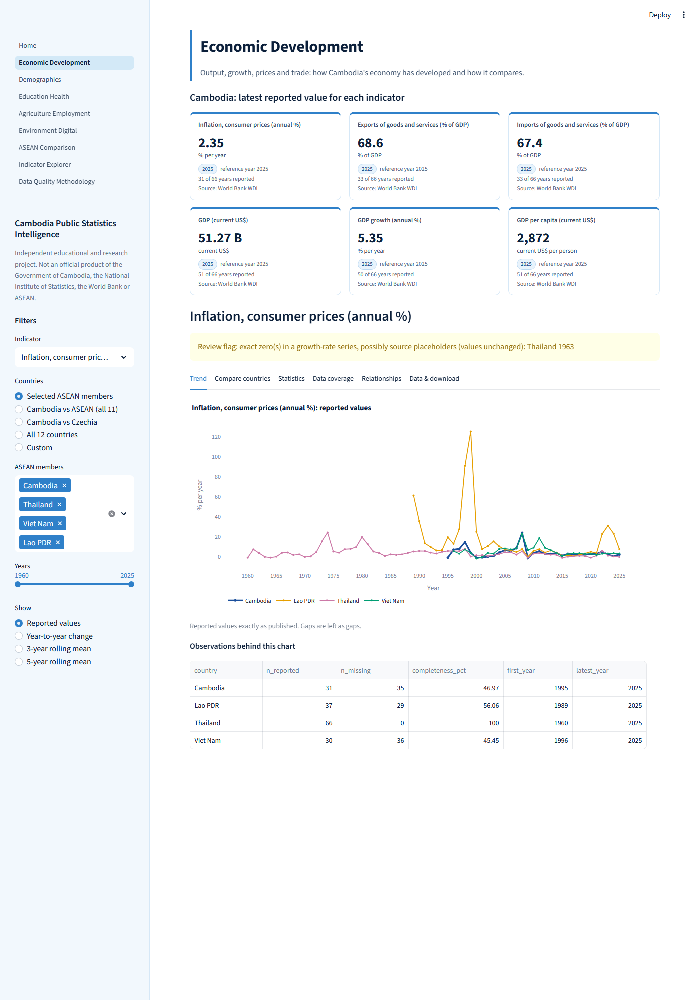
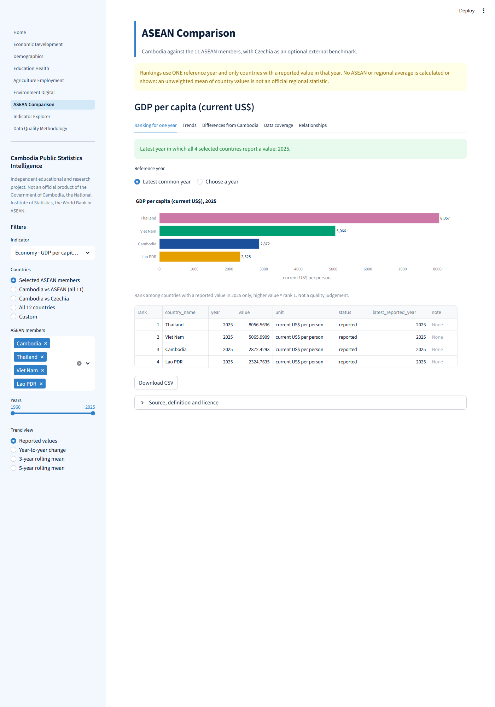
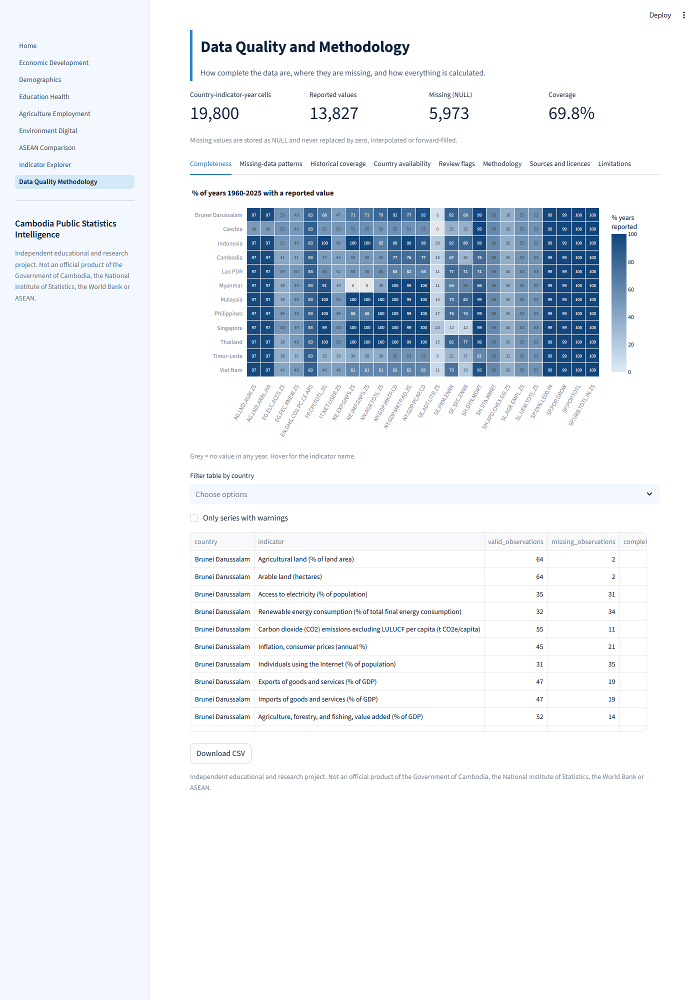
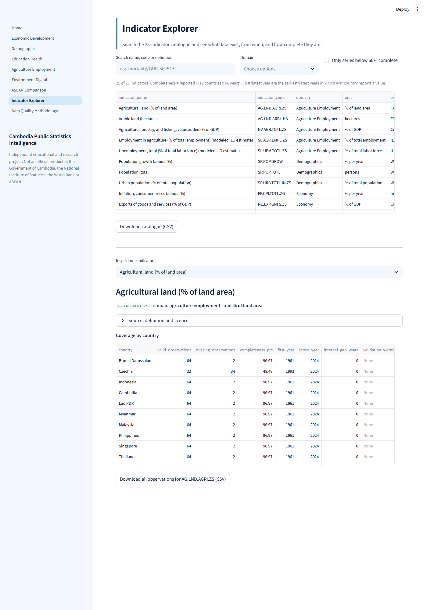

# Cambodia Public Statistics Intelligence

**An integrated national and ASEAN development data observatory.**

> Independent educational and research project. It is **not** an official product of the Government of Cambodia, the National Institute of Statistics, the World Bank or ASEAN. Status: research prototype v0.1.0 (see [Limitations](#17-research-limitations)).

## 1-2. Abstract

This project integrates 25 World Bank World Development Indicators for Cambodia, the ten other ASEAN members and Czechia (as an external benchmark) into a DuckDB store, and exposes them in a Streamlit observatory with descriptive statistics, trend analysis, exploratory correlation, outlier review flags, same-year country comparison and a data-quality dashboard. Its central design rule is honesty about missing data: 30.2% of the 19,800 country-indicator-year cells are missing in the source, and the application shows them instead of filling them.

## 3-5. Background, problem, objectives

Public development statistics are spread across portals with different structures, metadata and gaps. *Research question:* how can multi-source public statistical data integration and analytical visualisation improve access to information about Cambodia's socioeconomic development and its comparative position within Southeast Asia? Objectives: integrate public statistics; standardise country and indicator metadata; build a reproducible ingestion process; keep historical series; analyse trends; compare Cambodia with ASEAN; evaluate completeness; communicate methods and limits.

## 6. Data sources

Only the **World Bank Indicators API v2** (World Development Indicators) is used. WHO GHO (API returned HTTP 500 on 2026-10-31), ASEANstats (token required), UNData and FAOSTAT are deferred ([docs/NEXT_STEPS.md](docs/NEXT_STEPS.md)). Retrieval: 51 API calls on 2026-10-31, 19,800 rows. Licences and attribution: [docs/data_sources.md](docs/data_sources.md). **Licence caveat:** the World Bank default (CC BY 4.0) and, for the CO2 series, the owner's reading of the indicator page are recorded; the pipeline did not independently re-read licence pages, and third-party terms may apply to individual series.

## 7. Indicators (25, six domains)

Demographics (3), Economy (6), Agriculture and employment (5), Education (3), Health (4), Environment/energy/digital (4). Full list with units, definitions and original providers: Indicator Explorer page or [configs/indicators.yaml](configs/indicators.yaml). 24 candidate codes validated as specified. **One substitution:** `EN.ATM.CO2E.PC` is archived and serves no data; it is replaced by `EN.GHG.CO2.PC.CE.AR5` (EDGAR/JRC, CO2 excluding land use, t CO2e per capita, 1970-2024). The definitions differ and the two must not be joined into one series.

## 8. Countries

Brunei, Cambodia, Indonesia, Lao PDR, Malaysia, Myanmar, Philippines, Singapore, Thailand, Timor-Leste (ASEAN member since 2025-10-26, so earlier values predate membership), Viet Nam, plus Czechia (external benchmark, labelled as such).

## 9. Architecture


Details: [docs/architecture.md](docs/architecture.md). Data dictionary: [docs/data_dictionary.md](docs/data_dictionary.md).

## 10. Statistical methodology

Descriptive statistics on reported values with n shown; annual change only between consecutive reported years (percentage growth for levels/rates, **percentage-point change** for percent series, never mixed); 3- and 5-year rolling means that need all years present; Pearson/Spearman on aligned country-year pairs (minimum 8, exploratory, **no causal claim**); IQR and robust-z outlier flags that never alter data; same-year comparisons with no regional aggregate. No interpolation, forward fill or imputation anywhere. Full text: [docs/methodology.md](docs/methodology.md).

## 11. Screenshots

Captured from the running app with headless Edge (some pages need a long render budget; several screenshots were retaken because the first capture showed a loading skeleton or a half-rendered page).

| | |
|---|---|
|  |  |
|  |  |
|  | |

## 12-14. Install, run, refresh

```bash
python -m venv .venv && .venv/Scripts/activate      # Windows; use bin/activate on Linux/macOS
python -m pip install -r requirements.txt
python scripts/run_pipeline.py                      # download (cached) + build DuckDB + ingestion report
python -m streamlit run app/Home.py                 # http://localhost:8501 (bound to 127.0.0.1)
python scripts/run_pipeline.py --refresh            # re-download from the API
python scripts/run_pipeline.py --offline            # rebuild from the cache, no network
python scripts/phase4_report.py                     # regenerate reports/validation/phase4_statistics.md
```
The cache, database and Parquet export are generated and git-ignored. No API key or secret is needed.

## 15. Testing

`python -m pytest -q` and `python -m ruff check .` (results are recorded in `reports/validation/`). Final run on this commit: **81 passed, Ruff clean.** Coverage: mocked-HTTP ingestion tests (pagination, retry, timeout, invalid indicator, empty response, malformed payloads); transformation, null/zero and duplicate handling; deterministic statistics fixtures with hand-computed expected values; DuckDB key and constraint enforcement; cross-checks of descriptive statistics, growth, correlation and the CSV export against independent SQL/NumPy on the real data; headless Streamlit tests that run every page and exercise filters, the empty-search state and the missing-database error. **Not tested:** the live API in CI (no integration tests yet), cross-browser rendering, mobile layout. **GitHub Actions has not been run** (the account is billing-locked), so the workflow is unverified.

## 16. Findings from actual computations (World Bank data retrieved 2026-10-31)

All figures come from the stored data (see the application and `reports/validation/phase4_statistics.md`); each is descriptive.

* Cambodia's population: 5.45 M (1960) to 17.85 M (2025). Urban share: 10.2% to 41.1%. Life expectancy: 42.1 (1960) to 70.8 years (2024). Employment in agriculture: 75.3% (1991) to 33.4% (2025, modeled ILO estimate). Electricity access: 18.7% (1998) to 99.2% (2024).
* GDP per capita (current US$, nominal): 113.8 (1975) to 2,872 (2025). In 2025, among the 11 ASEAN members, Cambodia ranks 8th of 11 (Singapore 98,814; Timor-Leste 1,341).
* Across the 12 countries, GDP per capita and life expectancy are strongly rank-correlated (Spearman rho 0.90, n = 644 country-years; Cambodia alone rho 0.986, n = 50). Both rise over time for most countries, so this is a shared trend, not evidence that one drives the other.
* Data gaps: Myanmar has no export/import values; Czechia no adult literacy; Cambodian adult literacy has 10 observations (1998-2021); across all countries adult literacy has 99 reported values.
* **Review flag:** Cambodia's GDP growth is exactly 0.0 in 1976, 1978 and 1982 between values such as -14.7 and +0.04. This pattern is consistent with placeholders in the source but is not verified against a primary source; values are unchanged and flagged.

## 17. Research limitations

Single source; uneven coverage (30.2% missing); source does not distinguish kinds of missingness; nominal US-dollar comparisons; WDI revisions; correlations are exploratory on non-independent pairs; no regional aggregates, provincial data or map; licences not independently re-read; app tested with Streamlit's test harness plus manual headless screenshots only on desktop width. See [docs/limitations.md](docs/limitations.md).

## 18. Future improvements

WHO and authorised ASEANstats adapters, UNData, provincial data and map, clustering/PCA, forecasting, revision tracking, warehouse integration with Project 01, public deployment: [docs/NEXT_STEPS.md](docs/NEXT_STEPS.md).

## 19. References and attribution

World Bank, *World Development Indicators*, via the Indicators API (https://api.worldbank.org/v2/); original providers per indicator are in the `indicators` table (for example EDGAR/JRC and IEA for CO2). ASEAN membership: https://asean.org/about-us/. Code: MIT ([LICENSE](LICENSE)); data keep their own licences. Cite with [CITATION.cff](CITATION.cff).
