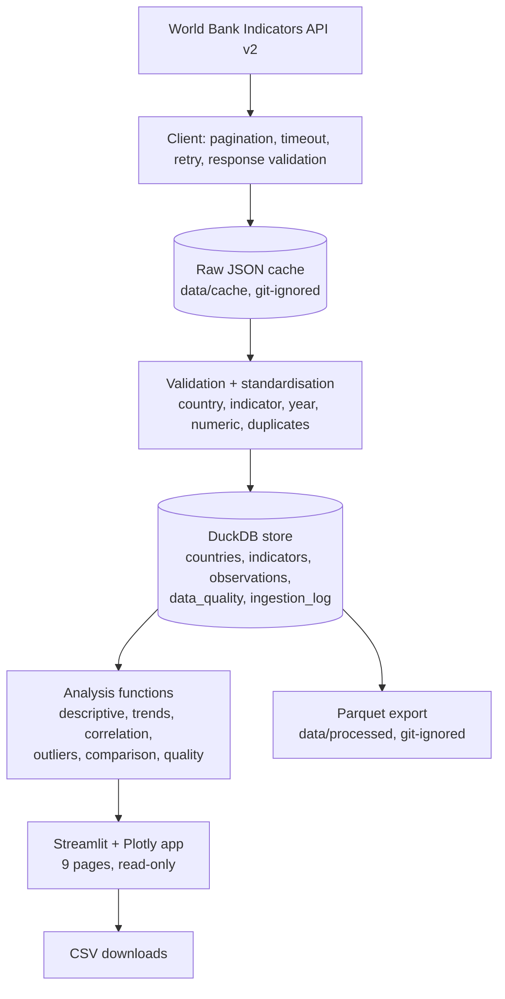

# Architecture

* **Ingestion** (`src/cpsi/ingestion/world_bank.py`, `scripts/download_data.py`): only the catalogue in `configs/` is requested (51 calls). Every response bundle stores URL, parameters, retrieval time and all pages; later builds run offline from the cache. `--refresh` re-downloads, `--offline` forbids network.
* **Transformation** (`src/cpsi/transformation/observations.py`): fails the whole load on unknown country, indicator mismatch, bad year, non-numeric value, out-of-window year or duplicate key. Missing stays NULL.
* **Store** (`src/cpsi/database/store.py`): DuckDB with primary keys, foreign keys and CHECK constraints (e.g. status 'missing' if and only if value is NULL). The app opens it read-only.
* **Analysis** (`src/cpsi/analysis/`): pure pandas functions, tested on deterministic fixtures and cross-checked against SQL on the real data (`tests/test_verification.py`).
* **App** (`app/`): `components/data.py` caches one load of the database; `components/domain_page.py` renders the five thematic pages; the app never calls an external API, so it works offline once the database exists.
* Design choices: DuckDB + Parquet instead of PostgreSQL (no server, reproducible with `pip`); no Docker; the code is organised under `src/cpsi/` rather than top-level packages so that no module shadows the standard-library `statistics`.

Refresh: `python scripts/run_pipeline.py [--refresh|--offline]`. Statistics report: `python scripts/phase4_report.py`.
